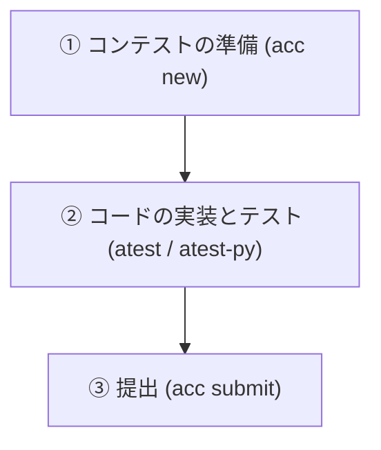

# AtCoder 自動化環境 使い方ガイド

このガイドでは，構築した自動化環境を使用して，AtCoderのコンテスト（例: ABC）に参加する際の具体的な手順を初心者向けに解説する．

---

## 1. 全体像：コンテスト中の基本的な流れ

自動化環境における作業は，以下の3ステップで完結する．



---

## 2. 推奨されるディレクトリ（フォルダ）の構成

本環境では，すべてのプログラムを `ABC/` フォルダの中で整理して管理する．

```text
atcoder-library/ (プロジェクトのルートフォルダ)
├── ABC/                   <-- [場所A] コンテストごとにフォルダを作る場所
│   ├── abc350/            <-- コンテスト名のフォルダ
│   │   ├── a/             <-- [場所B] A問題の作業場所
│   │   │   ├── main.cpp   <-- コードを記述するファイル
│   │   │   └── tests/     <-- 自動でダウンロードされたテストケースが入るフォルダ
│   │   ├── b/
│   │   └── ...
├── docs/                  <-- 解説ドキュメントが格納されているフォルダ
├── templates/             <-- ひな形（テンプレート）が格納されているフォルダ
└── tools/                 <-- 環境構築や使い方のガイド（本フォルダ）
```

---

## 3. ステップ・バイ・ステップでの操作手順

コンテストが開始したと仮定し，具体的なコマンド操作を追っていく．

### ステップ①：問題のダウンロード（コンテストの準備）
ターミナルを起動し，コンテスト用のフォルダを作成してテストケースをダウンロードする．

1. まず，コンテストフォルダを作る場所（ルート直下の `ABC/` フォルダ）へ移動する．
   ```bash
   cd ~/github/atcoder-library/ABC
   ```
2. 次に，参加するコンテスト名（例として `abc350`）を指定して，問題とテストケースを取得する．
   ```bash
   acc new abc350
   ```
   * **何が起きるか**: `ABC/` の中に `abc350/` というフォルダが作られ，その中に各問題（a, b, c...）のフォルダとテストケースが自動でダウンロードされる．さらに，設定したテンプレート（`main.cpp` または `main.py`）が自動でコピーされる．

---

### ステップ②：コードの記述と自動テスト
1. 解いたい問題のフォルダ（例としてA問題なら `abc350/a`）に移動する．
   ```bash
   cd abc350/a
   ```
2. エディタ（VS Codeなど）で `main.cpp`（または `main.py`）を開き，プログラムを記述する．
3. プログラムが書けたら，ターミナルで以下のテストコマンドを実行する．
   * **C++ の場合**:
     ```bash
     atest
     ```
   * **Python の場合**:
     ```bash
     atest-py
     ```
   * **何が起きるか**:
     * C++ の場合は自動でプログラムのコンパイルが行われ，エラーがあればターミナルに表示される．
     * コンパイルが成功すると，ダウンロードされたすべてのテストケース（入力例）がプログラムに流し込まれ，出力が正しいかどうか（ACかWAか）が自動で判定される．

**テスト結果の画面例 (成功時):**
```text
=== sample-1 ===
input:
1 2
output:
3
expected:
3
--> OK

=== sample-2 ===
...
--> OK

🥇 SUCCESS: All tests passed! (すべてのテストに合格)
```

もし `--> NG` (または `WA`) と表示された場合は，プログラムの出力が正しくないため，コードを修正して再度 `atest` を実行する．

---

### ステップ③：解答の提出
すべてのテストケースで `OK` が出たら，以下のコマンドを実行して提出する．
```bash
acc submit
```
* **何が起きるか**: 作成したプログラムが自動的に AtCoder のサーバーに送信される．ブラウザを開いて提出ボタンを押す必要はない．
* **注意**: 提出するファイルを聞かれた場合は，画面の指示に従って `main.cpp`（または `main.py`）を選択する．

---

## 4. 日常的に役立つテクニック

### 言語の使い分け（C++ と Python）
デフォルトでは C++ に設定されているが，状況に応じて Python 等に切り替えることが可能である．

* **今回だけ Python で作成したい場合**:
  `acc new` のコマンドを実行する際に，末尾にオプションを付与する．
  ```bash
  acc new abc350 --template python
  ```
* **デフォルトの言語を Python に変更したい場合**:
  ```bash
  acc config default-template python
  ```
* **デフォルトの言語を C++ に戻したい場合**:
  ```bash
  acc config default-template cpp
  ```

---

## 5. トラブルシューティング（困ったときは）

### Q1. 提出時やダウンロード時に「ログインしていない」とエラーが出る
**原因**: AtCoderのログインセッションが有効期限切れになっている，またはCookie情報が更新されていない可能性がある．
**対策**: [環境構築ガイド](setup_guide.md)の「2. ログイン設定」の手順に従い，ブラウザから新しい `REVEL_SESSION` を取得して再設定する．

### Q2. テストで `WA (Wrong Answer)` が出るが，どこが間違っているかわからない
**対策**: `tests/` フォルダの中に，テストケースの入力（例: `sample-1.in`）と正しい出力（例: `sample-1.out`）が保存されている．これらを確認し，自分のプログラムがどのような入力に対して誤った出力をしているかデバッグする．

### Q3. `atest` コマンドを実行した際に「コマンドが見つかりません」と出る
**原因**: `.bashrc` の設定が反映されていない可能性がある．
**対策**: ターミナルで以下のコマンドを実行し，設定を再読み込みする．
```bash
source ~/.bashrc
```
それでも解決しない場合は，[環境構築ガイド](setup_guide.md)の「4. 便利機能の設定 (エイリアス)」の設定が正しく行われているか確認する．

